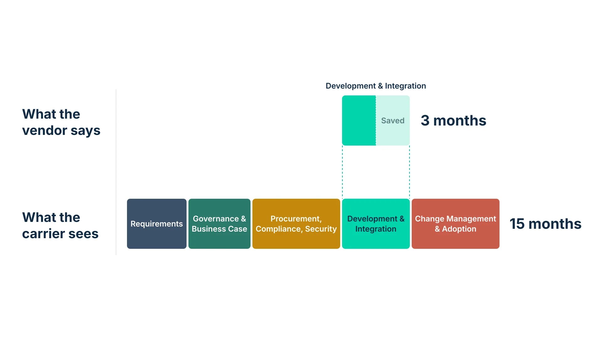

AI is everywhere. On Allstate's Q3 earnings call, CEO Tom Wilson reported that the company generated "over 12 million lines of code" using AI in a single quarter, "3.6x higher than the first quarter." 97% of employees are now "certified as AI-enabled."

Those are adoption numbers. They don't tell you how much faster a carrier gets from an approved idea to a capability people actually use.

AI coding tools are powerful, but they mainly shorten the development and integration work of a technology project. That's maybe 20% of the total time. Cut that in half and a 15-month project shortens to 13½ months. That is a real improvement. It is not a transformation of the delivery model.

McKinsey made this point in its April 2026 paper on agentic AI in insurance: "Rewriting code or configuring the new platform is a small fraction of the actual effort." The walkthrough below shows where the rest of the time goes.

## The anatomy of a carrier technology project

Let's walk through a "typical" project at a mid-sized carrier from start to end, let's say an underwriting platform. You'll object that "typical" doesn't exist, but stick with me. If you've lived through one of these projects, this will feel familiar.

<!-- Requirements -->

Months 1-3
Requirements

Three underwriting groups need this platform. Middle market wants custom workflows. Large accounts wants rate flexibility. Small commercial wants straight-through processing. Each group writes their own requirements. Then the consolidated requirements go through four revisions because nobody agreed the first time, or the second, or the third. Somewhere in month 2, actuarial asks for loss data integration and claims wants reporting feeds. That adds six weeks.

The underwriting groups are negotiating scope through the requirements document. They know that whatever makes it in gets built, and whatever doesn't waits another two years. The result is a requirements document that tries to satisfy everyone and commits to nothing.

<!-- Business case & governance -->

Months 3-5
Business case &amp; governance

The project needs to get approved by a committee. That means the project team has to put together a business case and get sign-offs. After some back-and-forth, the team agrees, half-heartedly, on the minimum benefits they need to commit to for a positive ROI, but it takes two rounds of review. The CIO presents the project alongside 10 others competing for the same discretionary budget.

Gartner estimates that 70-80% of carrier IT budgets go to maintaining existing systems. The discretionary slice is 20-30%. Ten projects competing for that pool means most of them lose, and the ones that win spend weeks proving they deserve the slot.

<!-- Procurement, compliance, security -->

Months 5-8
Procurement, compliance, security

The project got approved. Let's assume the carrier is engaging a vendor. That adds 8-12 weeks for RFPs, demos, reference calls, and contract negotiation. Then there are legal and information security reviews, compliance checks. If the carrier is building in-house instead, the architecture review and technology standards approval would fill a similar time window.

<!-- Development & integration (AI-accelerated) -->

Months 8-11
Development &amp; integration
AI accelerates this

This is the part where AI coding tools accelerate. Building the application, writing integrations, mapping data, testing the code. With AI tools, this phase can be cut in half or more, from 3 to 1½ months.

<!-- Change management & adoption -->

Months 11-15
Change management &amp; adoption

The underwriting platform is built. But we are still not ready. Next, you have to train the underwriters, the actuarial team, the claims team on the new workflows. That takes time. You run processes in parallel for a while. You fix what the test environment didn't catch. You adjust the configuration, because the business has evolved since you took down the requirements a year ago.

The Vendor Timeline Illusion

## The math

Development and integration is only 3 months out of a 15-month project, 20% of the total time. AI coding tools can cut that in half, maybe even more. But a carrier's transformation agenda was never stalled by the development time. It was stalled by the 8 months before and the 4 months after the development. AI coding tools don't shorten any of those.

## The vendor timeline illusion

When a vendor says "3 months to production," they are telling the truth. Their truth. The vendor counts from contract signing to code deployment. The carrier counts from the first requirements meeting to the last underwriter trained. Those are different clocks measuring different things, and the gap between them is where frustration accumulates.

I have seen this firsthand at a large carrier, where vendor timelines and delivery diverged by multiples. The vendor delivered on time, by their definition. The carrier was still a year away from using the system in production, by theirs.

## The knowledge that walked out the door

When carriers outsourced most of their technology twenty years ago, they lost more than just good developers. They lost the knowledge of how their systems connect, how data flows, what breaks when you change a data field upstream.

This matters now more than it did five years ago. AI coding tools assume someone still knows how it all fits together. They assume someone can describe the integration points, the data dependencies, the downstream effects of a schema change. At most carriers, that understanding walked out the door a long time ago. The outsourcing partners have pieces of it, but no single team holds the full picture.

A carrier trying to deploy AI tools into this environment runs into the same problem every new initiative has run into for the past decade: nobody can tell the development team exactly how the existing systems work. The documentation is incomplete. The original architects are gone. The workarounds that keep production running are undocumented. AI tools can write code faster, but they can't tell you what code to write.

AI coding tools assume someone still knows how it all fits together. At most carriers, that understanding walked out the door a long time ago.

## What needs to change

The real bottleneck in carrier technology projects is the decision speed, the integration knowledge, and the capacity to absorb change. Fixing those is the real work.

**Streamline governance without gutting it.** Governance, compliance, and security reviews are all necessary. But many carriers run the same heavyweight process for a $500K proof of concept and a $20M platform overhaul. Tiered governance, where smaller projects face lighter review cycles, can shave weeks without increasing risk. The oversight needs to match the scale of the commitment.

**Rebuild institutional knowledge.** Carriers need people who understand how their systems connect, not just how to code. This is different from hiring more developers. It means investing in architecture documentation, retaining the engineers who have institutional memory, and structuring vendor contracts so that knowledge transfers back to the carrier instead of staying with the outsourcing partner.

**Start change management with the project.** The underwriters who will use the new system in month 12 should be involved from month 1. They should see prototypes, provide feedback on workflows, and start adjusting their processes before the final system ships. AI tools make this easier than ever: a working prototype that took weeks to build now takes days, which means you can put something in front of users early and iterate. When change management starts after the code ships, you get months of parallel processing, rework, and frustration. And why doesn't change management start with the project, not when the code has shipped? Because the organization treats "building it" and "using it" as two separate problems. They are the same problem.

None of what I proposed makes for a great earnings call headline. But that is where the time disappears and the frustration grows.

AI writes code faster. The bottleneck was never the code.

<strong style="color: #0A2540;">Carrier Technology Series</strong> 
Previous: <a href="/insights/buy-build-or-wait/">Buy, Build, or Wait</a> — Core system vendors are acquiring the AI capabilities their carrier clients can't build.

